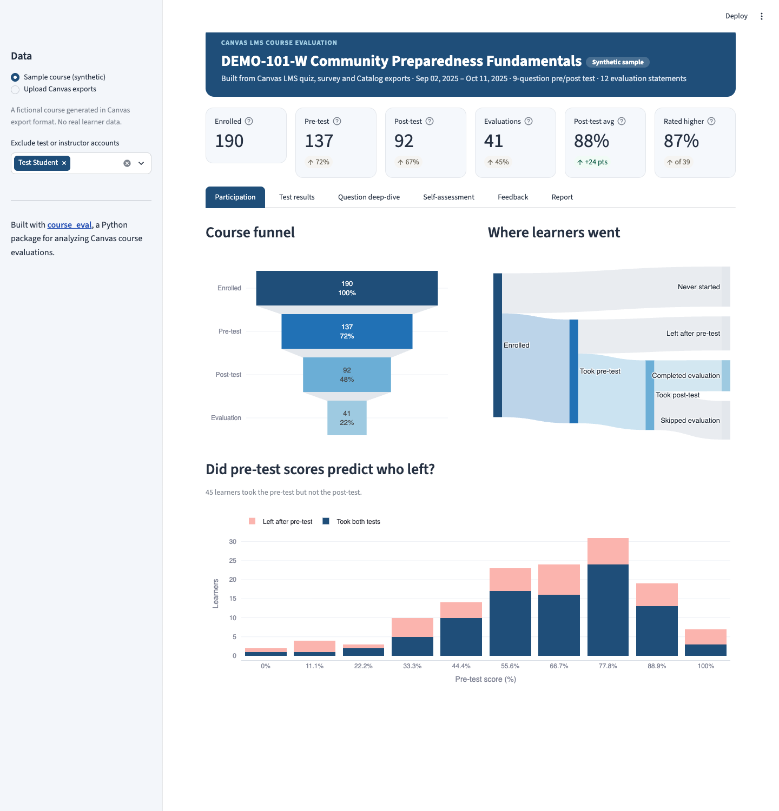
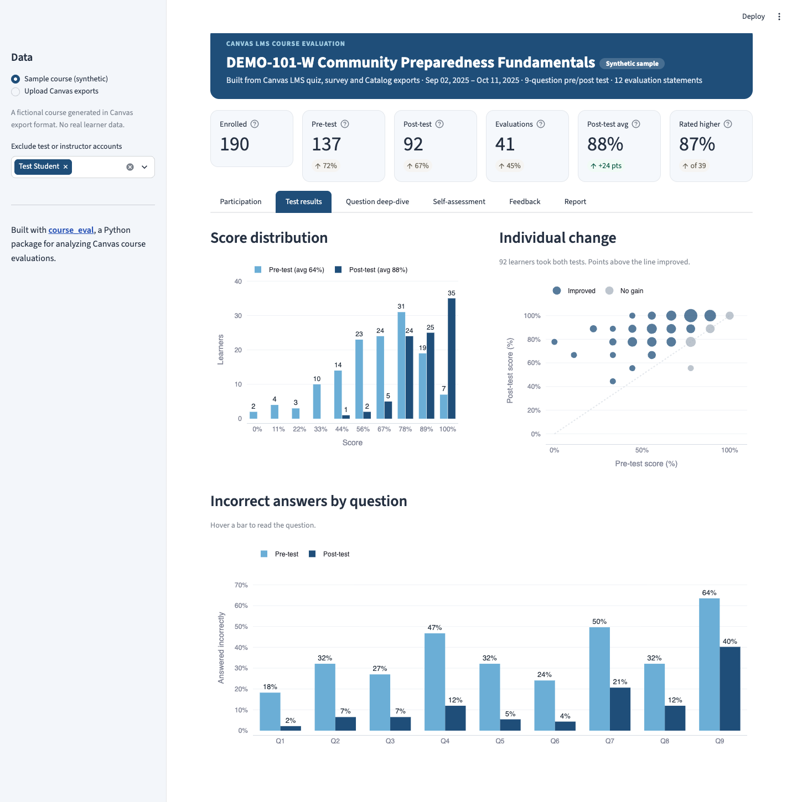
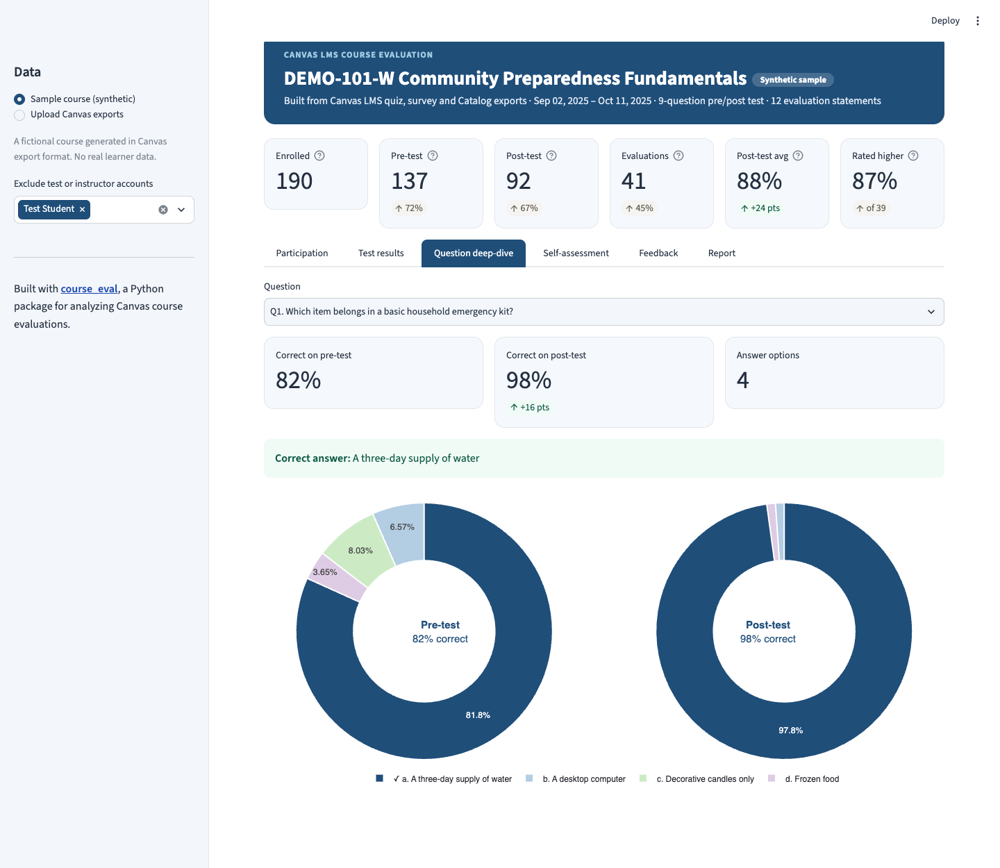
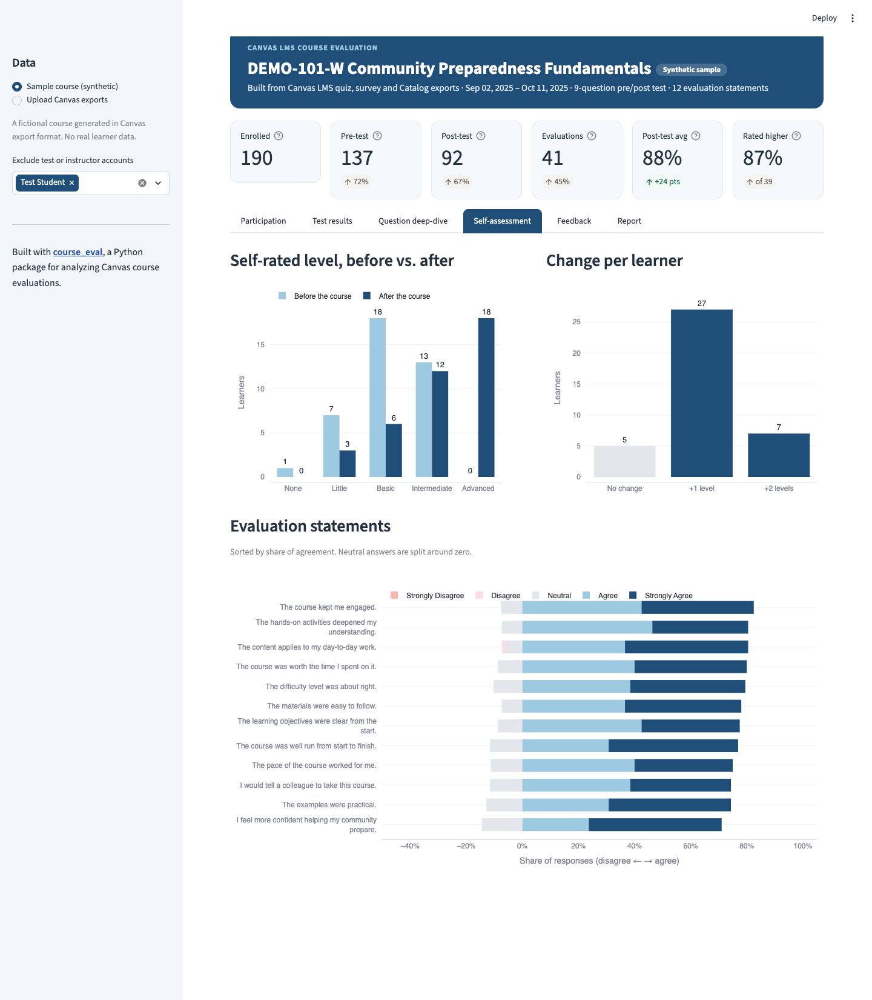
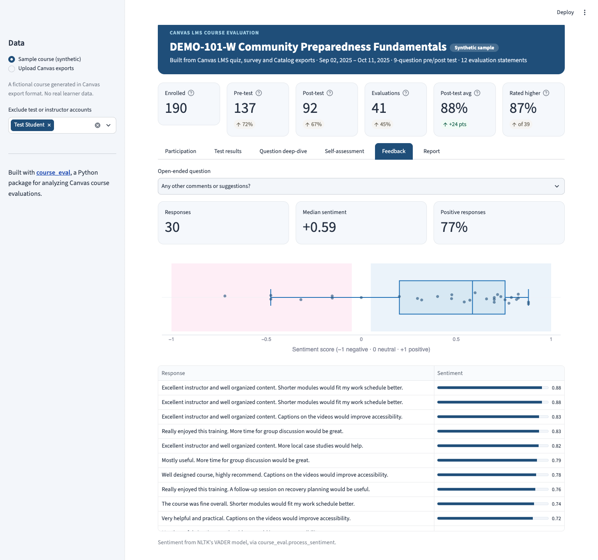

# Course Evaluation Dashboard

An interactive Streamlit dashboard that turns **Canvas LMS course exports** into a full course evaluation: participation, pre/post test results, question-level difficulty, self-assessed growth, and sentiment of learner feedback. It also generates a ready-to-edit **Word report**.

[](https://course-eval-dashboard.streamlit.app/)

It's built on [**course_eval**](https://github.com/AmeliaHuang325/course_eval), my Python package for analyzing course evaluations.



> The sample course in this repo is **synthetic**: a fictional course generated in Canvas export format. It contains no real learner data.

## Why I Built It

Evaluating a training course meant downloading four Canvas exports, cleaning them by hand, and rebuilding the same charts in a notebook for every course. I first packaged the analysis as [`course_eval`](https://github.com/AmeliaHuang325/course_eval) so it could be reused across courses. This dashboard is the next step: upload the exports and get the whole analysis interactively, with no notebook needed.

## What It Shows

| Tab | What you get |
|---|---|
| **Participation** | Course funnel, a Sankey diagram of where learners went, and whether pre-test scores predicted who left before the post-test |
| **Test results** | Pre vs. post score distributions, each learner's individual change, and the incorrect-answer rate for every question |
| **Question deep-dive** | Answer breakdown before and after the course for any question, with the correct answer highlighted |
| **Self-assessment** | Self-rated knowledge/skills level before vs. after, change per learner, and a diverging chart of agreement with each evaluation statement |
| **Feedback** | Sentiment (NLTK VADER) of every open-ended answer, with a searchable table of responses |
| **Report** | Auto-written key findings and a one-click Word report using `course_eval`'s charts |

| Test results | Question deep-dive |
|---|---|
|  |  |
| **Self-assessment** | **Feedback** |
|  |  |

## Works with Canvas LMS Exports

The app reads the standard exports as-is, with no reformatting:

| File | Where it comes from in Canvas |
|---|---|
| Pre-test | Quiz → Quiz Statistics → **Student Analysis** report (CSV) |
| Post-test | Quiz → Quiz Statistics → **Student Analysis** report (CSV) |
| Evaluation | Survey → Quiz Statistics → **Student Analysis** report (CSV) |
| Enrollments | **Canvas Catalog** enrollment export (CSV) |

What it handles automatically:
- **Learner records:** keeps each learner's latest attempt, matched on their Canvas user ID, and lets you exclude test or instructor accounts.
- **Question structure:** detects the questions, the pre/post pairs, the correct answers, the before/after self-rating pair, the agreement statements and the open-ended questions from Canvas's column layout.
- **Enrollment filtering:** keeps only this course's rows from a Catalog export that lists every course, matched on the quiz's section ID.
- **Privacy:** uploaded files are processed in memory for the session only, never stored. The repo's `.gitignore` blocks any CSV outside `sample_data/`.

## How It's Built

```
Canvas exports ──► course_eval                  (latest attempts, scoring, error rates, sentiment, report charts)
              └──► dashboard/data.py            (Canvas format detection, course filtering, summary metrics)
                    ├─► dashboard/charts.py     (interactive Plotly charts)
                    ├─► dashboard/report.py     (Word report with python-docx + course_eval charts)
                    └─► app.py                  (Streamlit UI)
```

**Stack:** Python · Streamlit · pandas · Plotly · matplotlib · NLTK (VADER) · python-docx · pytest

## Run It

```bash
pip install -r requirements.txt
streamlit run app.py
```

To regenerate the synthetic sample course, or run the tests:

```bash
python scripts/generate_sample_data.py
pytest
```

## Repository Structure

```
├── app.py                         # Streamlit app
├── dashboard/
│   ├── data.py                    # Load and prepare Canvas exports
│   ├── charts.py                  # Plotly charts
│   └── report.py                  # Word report
├── scripts/generate_sample_data.py  # Synthetic course in Canvas format (seeded)
├── sample_data/                   # The generated sample course
├── tests/                         # pytest
├── images/                        # Screenshots
└── .streamlit/config.toml         # Theme
```
